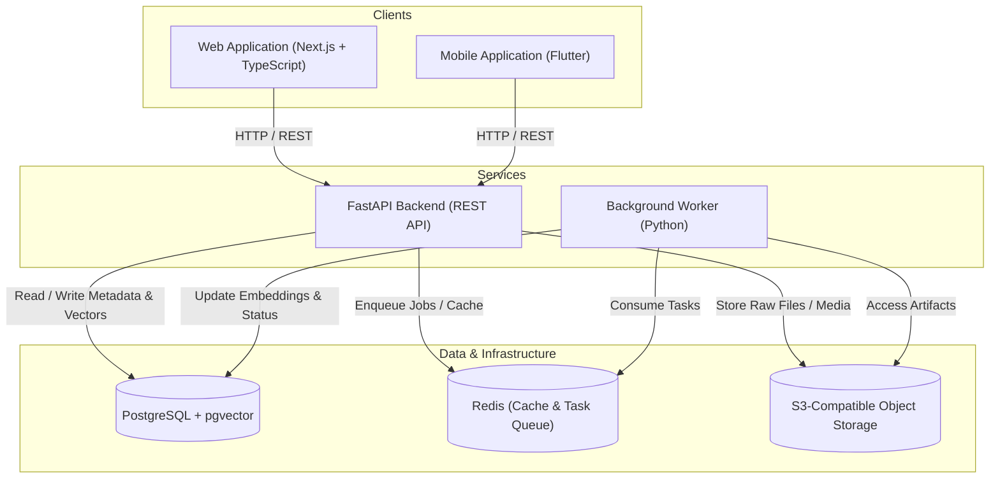

# LENS

> **A personal information capture and retrieval system**: anything you encounter and want to find again should be easy to capture, understand, connect, and retrieve.

[](https://github.com/hardikkaurani/Lens/actions)
[](https://opensource.org/licenses/MIT)
[](https://www.docker.com/)
[](https://nextjs.org/)
[](https://fastapi.tiangolo.com/)
[](https://flutter.dev/)
[](https://www.postgresql.org/)
[](https://github.com/pgvector/pgvector)

---

## 🚀 Current Status: **Stage 11 — Secure Binary File & PDF Capture Foundation**

> [!NOTE]
> LENS now supports secure binary document upload and asynchronous ingestion for PDF files. Uploaded documents are stored in local MinIO (S3-compatible object storage), validated with strict magic byte and size enforcement, indexed through bounded page-by-page text extraction, partitioned into deterministic chunks, embedded with 1536-dimensional vector representations, and made instantly searchable via the unified hybrid search API. OCR and image document processing remain explicitly deferred.

---

## 🎯 Core Problem

Modern knowledge work suffers from severe information fragmentation:

- Articles, documentation, code snippets, GitHub repositories, and thoughts are scattered across dozens of disconnected tools and browser tabs.
- Bookmarks and traditional note-taking apps turn into "write-only" archives where saved content is rarely discovered when needed.
- Keyword-based search breaks down when users remember concepts, context, or visual cues rather than exact strings.

---

## 🔄 Core Product Loop

```text
┌──────────────┐     ┌──────────────┐     ┌──────────────┐     ┌──────────────┐
│   CAPTURE    │ ──> │  UNDERSTAND  │ ──> │   CONNECT    │ ──> │   RETRIEVE   │
│ Web / Mobile │     │ Extract/Meta │     │ Graph/Vector │     │ Hybrid Search│
└──────────────┘     └──────────────┘     └──────────────┘     └──────────────┘
```

1. **Capture**: Seamless, low-friction entry point across web (browser extension / web dashboard) and mobile (share sheet / quick capture) for links, text, media, and integrations.
2. **Understand**: Automated extraction of content, summaries, metadata, and structural representations.
3. **Connect**: Link inference, topic clustering, and semantic vector embedding generation.
4. **Retrieve**: High-precision hybrid search (combining exact keyword matching and semantic similarity) resurfacing the right context at the right time.

---

## ✨ Main Capabilities (V1 Roadmap)

- **Omni-Capture Interface**: Unified ingestion for URLs, raw notes, GitHub repositories, and media.
- **Intelligent Processing Pipeline**: Asynchronous background jobs handling metadata extraction, text chunking, and embedding generation.
- **Hybrid Search Engine**: Combined lexical (PostgreSQL full-text) and semantic (pgvector) query execution.
- **Multi-Platform Access**: Responsive Next.js web application and cross-platform Flutter mobile application.
- **GitHub Integration**: Ingest starred repositories, releases, and issue notes via OAuth and webhooks.
- **Secure Storage**: Encrypted JWT authentication with private S3-compatible object storage for captured media and raw payloads.

---

## 🏗️ High-Level Architecture



---

## 📁 Repository Structure

```text
lens/
├── apps/
│   ├── web/          # Next.js 16 web application (Active)
│   └── mobile/       # Flutter Android application (Active)
├── services/
│   ├── api/          # FastAPI REST API service (Active)
│   └── worker/       # Python background processing worker (Active)
├── packages/         # Shared libraries and configurations
├── infra/            # Docker, local development, and deployment specs
├── docs/             # Engineering and architectural documentation
│   └── architecture.md
├── .editorconfig     # Consistent cross-editor formatting rules
├── .gitignore        # Comprehensive ignore rules for all tech stacks
└── README.md         # This file
```

---

## 🛠️ Technology Stack

| Layer | Technology | Status |
| :--- | :--- | :--- |
| **Web Frontend** | Next.js 16 (App Router, Turbopack), React 19, TypeScript 5 | ✅ **Active** |
| **Mobile Frontend** | Flutter 3.41+, Dart 3.11+, Material 3 | ✅ **Active** |
| **Backend API** | FastAPI 0.115+, Python 3.11+, Pydantic v2 | ✅ **Active** |
| **Background Worker** | Python 3.11+, BeautifulSoup4, HTTPX, pypdf | ✅ **Active** |
| **Primary Database** | PostgreSQL 16 + `pgvector` extension | ✅ **Active** |
| **Cache & Queue** | Redis 7.4 (Reliable List Queue via `BLMOVE`) | ✅ **Active** |
| **Object Storage** | S3-Compatible (MinIO) | ✅ **Active** |
| **Authentication** | JWT (Access + Refresh) + HttpOnly Cookies | 🚧 **In Progress** (Stage 19) |
| **Integrations** | GitHub OAuth & Webhooks | 📋 **Planned** |
| **Local Containerization** | Docker & Docker Compose | ✅ **Active** |

---

## ⚡ Quick Start

### Prerequisites

- **Node.js**: v20+ LTS (v26.5.0 verified)
- **Python**: v3.11.9+ with `pip`
- **Flutter SDK**: v3.20+ (for mobile)
- **Docker & Docker Compose**: For backing services
- **Git**: v2.40+

### 1. Clone & Configure

```bash
git clone https://github.com/hardikkaurani/Lens.git
cd Lens
cp .env.example .env
# Edit .env with your local values (defaults work for local dev)
```

### 2. Start Infrastructure

```bash
docker compose -f infra/docker-compose.yml up -d
# Verify: Postgres (5432), Redis (6379), MinIO (9000/9001)
```

### 3. Backend API (FastAPI)

```bash
cd services/api
python -m venv .venv
source .venv/bin/activate  # or .\.venv\Scripts\Activate.ps1 on Windows
pip install -r requirements.txt
alembic upgrade head
uvicorn app.main:app --reload --host 0.0.0.0 --port 8000
# Health check: curl http://localhost:8000/health
```

### 4. Background Worker

```bash
cd services/worker
# Use the same venv as API or create separate
python -m worker.main           # Continuous mode
python -m worker.main --once    # Single job mode
```

### 5. Web App (Next.js)

```bash
cd apps/web
npm install
npm run dev
# Open http://localhost:3000
```

### 6. Mobile App (Flutter)

```bash
cd apps/mobile
flutter pub get
flutter run
# Configure API base URL in-app via Server Config dialog
```

---

## 🔌 API Highlights

### Capture Ingestion
| Method | Endpoint | Description |
| :--- | :--- | :--- |
| `POST` | `/captures` | Ingest URL or text capture |
| `GET` | `/captures` | Paginated list (newest first) |
| `GET` | `/captures/{id}` | Single capture with metadata |
| `POST` | `/captures/upload` | Upload PDF binary (multipart) |

### Hybrid Search
```bash
curl "http://localhost:8000/search?q=fastapi+async&limit=5"
```

Returns grouped results with `hybrid_score`, `lexical_score`, `semantic_score`, and matching chunk excerpts.

---

## 🌐 Web Workspace (`apps/web`)

- **Routes**: `/captures`, `/captures/new`, `/captures/[id]`, `/search`, `/settings`, `/login`, `/register`
- **Features**: Source badges, status indicators, bounded live polling, race-condition-safe search, XSS/URL injection defense
- **Commands**: `npm run dev`, `npm run test` (31 tests), `npm run typecheck`, `npm run lint`, `npm run build`

---

## 📱 Mobile App (`apps/mobile`)

- **Screens**: Captures feed, New Capture (URL/Note tabs), Capture Detail, Search, Server Config
- **Connectivity**: USB reverse proxy (`adb reverse tcp:8000 tcp:8000`), Wi-Fi LAN, Emulator preset
- **Commands**: `flutter pub get`, `flutter analyze`, `flutter test` (13 tests), `flutter build apk --debug`, `flutter run`

---

## 🛡️ Security & Secrets

> [!CAUTION]
> **NEVER commit secrets, API keys, tokens, certificates, or `.env*` files.**

- All config via local uncommitted `.env` or system env vars
- Templates only as `.env.example` / `.env.*.example`
- `.gitignore` enforces strict credential ignoring

---

## 🤝 Contributing

1. **Fork** the repository
2. **Create a branch**: `git checkout -b feat/your-feature` or `fix/your-fix`
3. **Make changes** with clear, focused commits
4. **Run checks**:
   - Web: `npm run typecheck && npm run lint && npm run test`
   - API: `ruff check . && pytest`
   - Mobile: `flutter analyze && flutter test`
5. **Open a PR** with a clear description and linked issues

### Commit Message Convention
Follows [Conventional Commits](https://www.conventionalcommits.org/):
- `feat:` — new feature
- `fix:` — bug fix
- `docs:` — documentation
- `refactor:` — code restructuring
- `test:` — test changes
- `chore:` — maintenance

---

## 📄 License

**MIT License** — see [LICENSE](LICENSE) for details.

---

## 🙏 Acknowledgments

Built with ❤️ using excellent open-source tools:
- [Next.js](https://nextjs.org/), [React](https://react.dev/), [TailwindCSS](https://tailwindcss.com/)
- [FastAPI](https://fastapi.tiangolo.com/), [SQLAlchemy](https://www.sqlalchemy.org/), [Alembic](https://alembic.sqlalchemy.org/)
- [Flutter](https://flutter.dev/), [Dart](https://dart.dev/)
- [PostgreSQL](https://www.postgresql.org/), [pgvector](https://github.com/pgvector/pgvector)
- [Redis](https://redis.io/), [MinIO](https://min.io/)
- [BeautifulSoup](https://www.crummy.com/software/BeautifulSoup/), [pypdf](https://pypdf.readthedocs.io/)

---

> **LENS** — *Capture. Understand. Connect. Retrieve.*