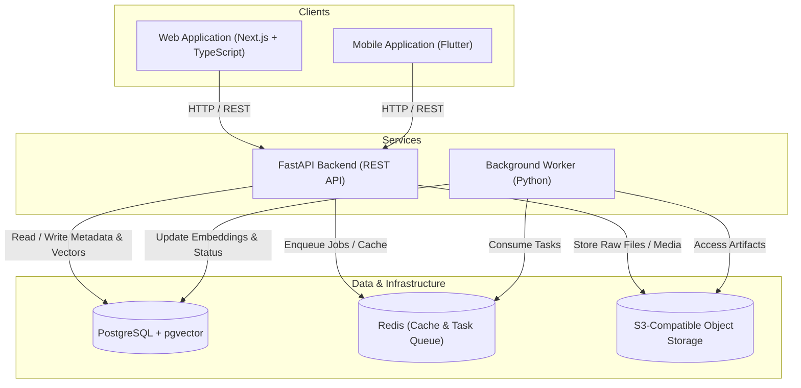

# LENS

> A personal information capture and retrieval system: anything you encounter and want to find again should be easy to capture, understand, connect, and retrieve.

---

## Current Status: Foundation / Stage 1

> [!NOTE]
> This repository is currently in **Stage 1 (Monorepo Foundation)**. The workspace structure, documentation, `.gitignore`, and tooling configurations are initialized. No product features, application code, database schemas, or third-party dependencies are implemented or installed yet.

---

## Core Problem

Modern knowledge work suffers from severe information fragmentation:
- Articles, documentation, code snippets, GitHub repositories, and thoughts are scattered across dozens of disconnected tools and browser tabs.
- Bookmarks and traditional note-taking apps turn into "write-only" archives where saved content is rarely discovered when needed.
- Keyword-based search breaks down when users remember concepts, context, or visual cues rather than exact strings.

---

## Core Product Loop

```
┌──────────────┐     ┌──────────────┐     ┌──────────────┐     ┌──────────────┐
│   CAPTURE    │ ──> │  UNDERSTAND  │ ──> │   CONNECT    │ ──> │   RETRIEVE   │
│ Web / Mobile │     │ Extract/Meta │     │ Graph/Vector │     │ Hybrid Search│
└──────────────┘     └──────────────┘     └──────────────┘     └──────────────┘
```

1. **Capture**: Seamless, low-friction entry point across web (browser extension / web dashboard) and mobile (share sheet / quick capture) for links, text, media, and integrations.
2. **Understand**: Automated extraction of content, summaries, metadata, and structural representations.
3. **Connect**: Link inference, topic clustering, and semantic vector embedding generation.
4. **Retrieve**: High-precision hybrid search (combining exact keyword matching and semantic similarity) resurfacing the right context at the right time.

---

## Main Capabilities Planned for V1

* **Omni-Capture Interface**: Unified ingestion for URLs, raw notes, GitHub repositories, and media.
* **Intelligent Processing Pipeline**: Asynchronous background jobs handling metadata extraction, text chunking, and embedding generation.
* **Hybrid Search Engine**: Combined lexical (PostgreSQL full-text) and semantic (pgvector) query execution.
* **Multi-Platform Access**: Responsive Next.js web application and cross-platform Flutter mobile application.
* **GitHub Integration**: Ingest starred repositories, releases, and issue notes via OAuth and webhooks.
* **Secure Storage**: Encrypted JWT authentication with private S3-compatible object storage for captured media and raw payloads.

---

## High-Level Architecture (Planned)



---

## Repository Structure

```
lens/
├── apps/
│   ├── web/          # Next.js web application [PLANNED]
│   └── mobile/       # Flutter mobile application [PLANNED]
├── services/
│   ├── api/          # FastAPI REST API service [PLANNED]
│   └── worker/       # Python background processing worker [PLANNED]
├── packages/         # Shared libraries and configurations [PLANNED]
├── infra/            # Docker, local development, and deployment specs [PLANNED]
├── docs/             # Engineering and architectural documentation
│   └── architecture.md
├── .editorconfig     # Consistent cross-editor formatting rules
├── .gitignore        # Comprehensive ignore rules for all tech stacks
└── README.md         # Repository overview and development guide
```

---

## Technology Stack

| Layer | Technology | Status |
| :--- | :--- | :--- |
| **Web Frontend** | Next.js (React), TypeScript | *Planned* |
| **Mobile Frontend** | Flutter, Dart | *Planned* |
| **Backend API** | FastAPI, Python 3.11+ | *Planned* |
| **Background Worker** | Python | *Planned* |
| **Primary Database** | PostgreSQL + `pgvector` extension | *Planned* |
| **Cache & Queue** | Redis | *Planned* |
| **Object Storage** | S3-Compatible (MinIO / AWS S3) | *Planned* |
| **Authentication** | JWT (Initial) | *Planned* |
| **Integrations** | GitHub OAuth & Webhooks | *Planned* |
| **Local Containerization** | Docker & Docker Compose | *Planned* |

---

## Local Development Prerequisites

Before setting up application components in subsequent stages, verify that your workstation has the following tooling installed:

- **Node.js**: v20+ LTS recommended (v26.5.0 verified)
- **Node Package Manager**: `pnpm` / `npm` / `bun`
- **Python**: v3.11.9+ with `pip`
- **Flutter SDK**: v3.20+ (v3.41.7 verified) & **Dart SDK** (v3.11.5 verified)
- **Android SDK / ADB**: For mobile device emulation and debugging
- **Docker & Docker Compose**: For running local databases, caches, and object storage
- **Git**: v2.40+ (v2.55.0 verified)

---

## Development Principles

1. **Separation of Concerns**: Client applications (Web, Mobile) consume standard API contracts; backend services (API, Worker) decouple ingestion from processing.
2. **Asynchronous by Default**: Heavy tasks (embedding calculations, OCR, large link scraping) must never block API responses; they are handled via worker queues.
3. **Reproducible Environments**: Local development dependencies and databases run in containerized environments with pinned versions.
4. **Resilient Data Capture**: Ingestion endpoints must acknowledge receipt quickly, persist raw payloads first, and process transformations idempotently.

---

## Security & Secrets Management

> [!CAUTION]
> **CRITICAL RULE**: Secrets, API keys, private tokens, certificates, and `.env*` files **MUST NEVER** be committed to version control.

* All environment configurations must be supplied via local uncommitted `.env` files or system environment variables.
* Reference templates must be provided exclusively as `.env.example` or `.env.*.example`.
* The root `.gitignore` enforces strict ignoring of credential and environment files.