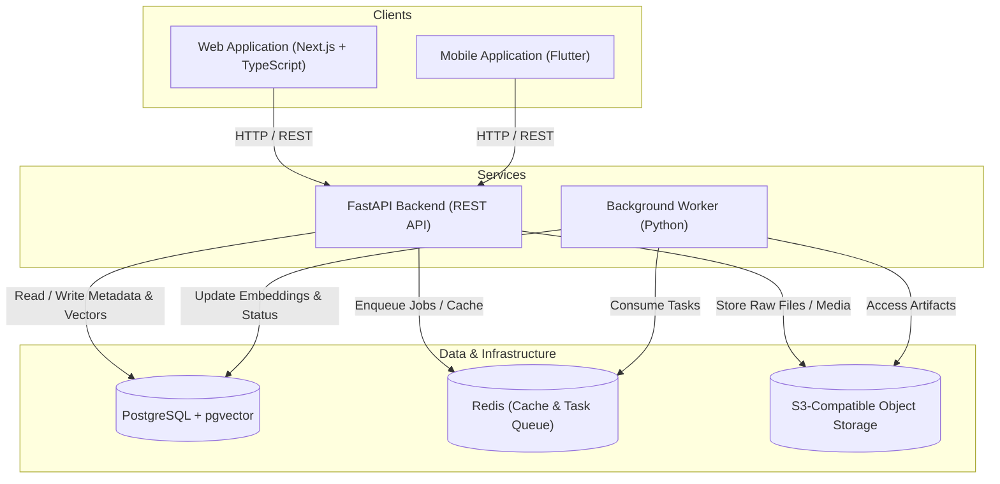

# LENS

> A personal information capture and retrieval system: anything you encounter and want to find again should be easy to capture, understand, connect, and retrieve.

---

## Current Status: FastAPI Backend Foundation / Stage 3

> [!NOTE]
> This repository is currently in **Stage 3 (Core FastAPI Backend Foundation)**. The monorepo foundation, local infrastructure (`infra/docker-compose.yml`), and foundational backend service (`services/api/`) with async PostgreSQL (pgvector) and Redis connectivity verification via `GET /health` are established. Product features, schemas, auth, and frontend applications remain planned for upcoming stages.

---

## Core Problem

Modern knowledge work suffers from severe information fragmentation:
- Articles, documentation, code snippets, GitHub repositories, and thoughts are scattered across dozens of disconnected tools and browser tabs.
- Bookmarks and traditional note-taking apps turn into "write-only" archives where saved content is rarely discovered when needed.
- Keyword-based search breaks down when users remember concepts, context, or visual cues rather than exact strings.

---

## Core Product Loop

```
┌──────────────┐     ┌──────────────┐     ┌──────────────┐     ┌──────────────┐
│   CAPTURE    │ ──> │  UNDERSTAND  │ ──> │   CONNECT    │ ──> │   RETRIEVE   │
│ Web / Mobile │     │ Extract/Meta │     │ Graph/Vector │     │ Hybrid Search│
└──────────────┘     └──────────────┘     └──────────────┘     └──────────────┘
```

1. **Capture**: Seamless, low-friction entry point across web (browser extension / web dashboard) and mobile (share sheet / quick capture) for links, text, media, and integrations.
2. **Understand**: Automated extraction of content, summaries, metadata, and structural representations.
3. **Connect**: Link inference, topic clustering, and semantic vector embedding generation.
4. **Retrieve**: High-precision hybrid search (combining exact keyword matching and semantic similarity) resurfacing the right context at the right time.

---

## Main Capabilities Planned for V1

* **Omni-Capture Interface**: Unified ingestion for URLs, raw notes, GitHub repositories, and media.
* **Intelligent Processing Pipeline**: Asynchronous background jobs handling metadata extraction, text chunking, and embedding generation.
* **Hybrid Search Engine**: Combined lexical (PostgreSQL full-text) and semantic (pgvector) query execution.
* **Multi-Platform Access**: Responsive Next.js web application and cross-platform Flutter mobile application.
* **GitHub Integration**: Ingest starred repositories, releases, and issue notes via OAuth and webhooks.
* **Secure Storage**: Encrypted JWT authentication with private S3-compatible object storage for captured media and raw payloads.

---

## High-Level Architecture (Planned)



---

## Repository Structure

```
lens/
├── apps/
│   ├── web/          # Next.js web application [PLANNED]
│   └── mobile/       # Flutter mobile application [PLANNED]
├── services/
│   ├── api/          # FastAPI REST API service [PLANNED]
│   └── worker/       # Python background processing worker [PLANNED]
├── packages/         # Shared libraries and configurations [PLANNED]
├── infra/            # Docker, local development, and deployment specs [PLANNED]
├── docs/             # Engineering and architectural documentation
│   └── architecture.md
├── .editorconfig     # Consistent cross-editor formatting rules
├── .gitignore        # Comprehensive ignore rules for all tech stacks
└── README.md         # Repository overview and development guide
```

---

## Technology Stack

| Layer | Technology | Status |
| :--- | :--- | :--- |
| **Web Frontend** | Next.js (React), TypeScript | *Planned* |
| **Mobile Frontend** | Flutter, Dart | *Planned* |
| **Backend API** | FastAPI, Python 3.11+ | **Active Foundation** (`services/api/`) |
| **Background Worker** | Python | *Planned* |
| **Primary Database** | PostgreSQL 16 + `pgvector` extension | **Infra Configured** (`infra/docker-compose.yml`) |
| **Cache & Queue** | Redis 7.4 | **Infra Configured** (`infra/docker-compose.yml`) |
| **Object Storage** | S3-Compatible (MinIO) | **Infra Configured** (`infra/docker-compose.yml`) |
| **Authentication** | JWT (Initial) | *Planned* |
| **Integrations** | GitHub OAuth & Webhooks | *Planned* |
| **Local Containerization** | Docker & Docker Compose | **Active / Tested** |

---

## Local Development Prerequisites

Before setting up application components in subsequent stages, verify that your workstation has the following tooling installed:

- **Node.js**: v20+ LTS recommended (v26.5.0 verified)
- **Node Package Manager**: `pnpm` / `npm` / `bun`
- **Python**: v3.11.9+ with `pip`
- **Flutter SDK**: v3.20+ (v3.41.7 verified) & **Dart SDK** (v3.11.5 verified)
- **Android SDK / ADB**: For mobile device emulation and debugging
- **Docker & Docker Compose**: For running local databases, caches, and object storage
- **Git**: v2.40+ (v2.55.0 verified)

---

## Local Development & Infrastructure

### 1. Backing Services Quickstart

To run the local backing services (PostgreSQL with pgvector, Redis, and MinIO), follow these steps:

1. **Start Docker Desktop**:
   Ensure the Docker daemon is running on your host machine.

2. **Copy `.env.example` to `.env`**:
   ```bash
   cp .env.example .env
   ```
   > [!CAUTION]
   > **CRITICAL RULE**: The `.env` file contains local secrets and must **NEVER** be committed to version control. The repository's `.gitignore` explicitly prevents tracking this file.

3. **Fill Only Required Values for Local Development**:
   For local development of infrastructure, the default values provided in `.env.example` for PostgreSQL (`lens_user`, `lens_password`, `lens`), Redis (`localhost:6379`), and MinIO (`minioadmin`/`minioadmin`) are functional defaults for local usage.

   **Credentials NOT required at this stage** (features are planned and not yet implemented):
   - `JWT_SECRET`, `JWT_ACCESS_TOKEN_EXPIRE_MINUTES`, `JWT_REFRESH_TOKEN_EXPIRE_DAYS` — Authentication service is not yet built.
   - `GITHUB_CLIENT_ID`, `GITHUB_CLIENT_SECRET`, `GITHUB_WEBHOOK_SECRET` — GitHub integration is not yet implemented.
   - `AI_PROVIDER`, `AI_API_KEY` — Embedding and LLM pipelines are not yet implemented.

4. **Start Infrastructure with Docker Compose**:
   ```bash
   docker compose -f infra/docker-compose.yml up -d
   ```

5. **Check Service Health**:
   ```bash
   docker compose -f infra/docker-compose.yml ps
   ```
   All three services should report healthy:
   - `lens-postgres` (PostgreSQL 16 with pgvector on port `5432`)
   - `lens-redis` (Redis 7.4 on port `6379`)
   - `lens-minio` (MinIO S3 API on port `9000`, Web Console on port `9001`)

6. **Stop Infrastructure When Finished**:
   ```bash
   docker compose -f infra/docker-compose.yml down
   ```
   *Note: Named volumes (`lens_postgres_data`, `lens_redis_data`, `lens_minio_data`) are preserved across stops. Add `-v` only if you explicitly intend to delete local data.*

### 2. FastAPI Backend Service (`services/api/`)

The core API service provides the backend foundation for LENS:

* **Location**: `services/api/`
* **Python Environment Setup**:
  ```bash
  cd services/api
  python -m venv .venv
  # Windows PowerShell
  .\.venv\Scripts\Activate.ps1
  # Linux / macOS
  source .venv/bin/activate
  ```
* **Dependency Installation**:
  ```bash
  pip install -r requirements.txt
  ```
* **Prerequisites**: Ensure local infrastructure (PostgreSQL and Redis) is running via Docker Compose (`docker compose -f infra/docker-compose.yml up -d`).
* **Start API Locally**:
  ```bash
  # From services/api/
  uvicorn app.main:app --reload --host 0.0.0.0 --port 8000
  ```
* **Verify Health**:
  ```bash
  curl http://localhost:8000/health
  ```
  Expected response when all dependencies are healthy:
  ```json
  {"status":"ok","api":"ok","database":"ok","redis":"ok"}
  ```
  If PostgreSQL or Redis is unreachable, the endpoint returns `503 Service Unavailable` with `status: "degraded"` and identifies the failing component without exposing internal credentials or tracebacks.
* **Current API Scope**:
  - Foundational application structure (`app/core`, `app/db`, `app/health`).
  - Configuration loader (`pydantic-settings`).
  - Asynchronous SQLAlchemy engine (`asyncpg`) and Redis client.
  - Active connectivity health checks (`GET /health`).
  - *NOT YET IMPLEMENTED*: Authentication, user management, application data models, migrations, search, embeddings, file ingestion, or external integrations.

---

## Development Principles

1. **Separation of Concerns**: Client applications (Web, Mobile) consume standard API contracts; backend services (API, Worker) decouple ingestion from processing.
2. **Asynchronous by Default**: Heavy tasks (embedding calculations, OCR, large link scraping) must never block API responses; they are handled via worker queues.
3. **Reproducible Environments**: Local development dependencies and databases run in containerized environments with pinned versions.
4. **Resilient Data Capture**: Ingestion endpoints must acknowledge receipt quickly, persist raw payloads first, and process transformations idempotently.

---

## Security & Secrets Management

> [!CAUTION]
> **CRITICAL RULE**: Secrets, API keys, private tokens, certificates, and `.env*` files **MUST NEVER** be committed to version control.

* All environment configurations must be supplied via local uncommitted `.env` files or system environment variables.
* Reference templates must be provided exclusively as `.env.example` or `.env.*.example`.
* The root `.gitignore` enforces strict ignoring of credential and environment files.