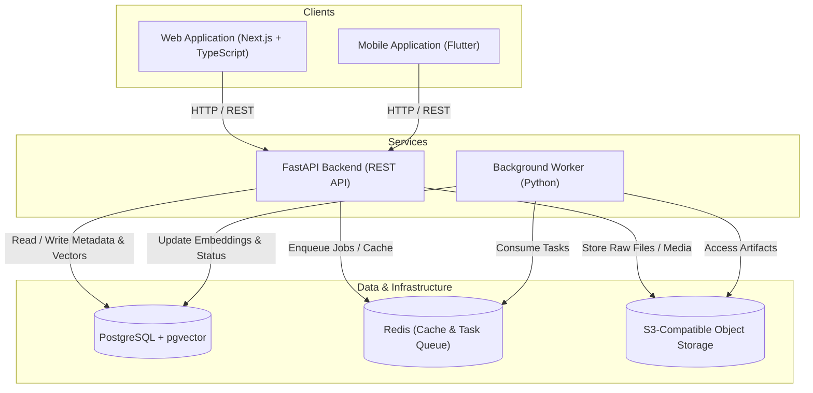

# LENS

> A personal information capture and retrieval system: anything you encounter and want to find again should be easy to capture, understand, connect, and retrieve.

---

## Current Status: Secure Binary File & PDF Capture Foundation / Stage 11

> [!NOTE]
> This repository is currently in **Stage 11 (Secure Binary File & PDF Capture Foundation)**. LENS now supports secure binary document upload and asynchronous ingestion for PDF files. Uploaded documents are stored in local MinIO (S3-compatible object storage), validated with strict magic byte and size enforcement, indexed through bounded page-by-page text extraction, partitioned into deterministic chunks, embedded with 1536-dimensional vector representations, and made instantly searchable via the unified hybrid search API. OCR and image document processing remain explicitly deferred.


---

## Core Problem

Modern knowledge work suffers from severe information fragmentation:

- Articles, documentation, code snippets, GitHub repositories, and thoughts are scattered across dozens of disconnected tools and browser tabs.
- Bookmarks and traditional note-taking apps turn into "write-only" archives where saved content is rarely discovered when needed.
- Keyword-based search breaks down when users remember concepts, context, or visual cues rather than exact strings.

---

## Core Product Loop

```text
┌──────────────┐     ┌──────────────┐     ┌──────────────┐     ┌──────────────┐
│   CAPTURE    │ ──> │  UNDERSTAND  │ ──> │   CONNECT    │ ──> │   RETRIEVE   │
│ Web / Mobile │     │ Extract/Meta │     │ Graph/Vector │     │ Hybrid Search│
└──────────────┘     └──────────────┘     └──────────────┘     └──────────────┘
```

1. **Capture**: Seamless, low-friction entry point across web (browser extension / web dashboard) and mobile (share sheet / quick capture) for links, text, media, and integrations.
2. **Understand**: Automated extraction of content, summaries, metadata, and structural representations.
3. **Connect**: Link inference, topic clustering, and semantic vector embedding generation.
4. **Retrieve**: High-precision hybrid search (combining exact keyword matching and semantic similarity) resurfacing the right context at the right time.

---

## Main Capabilities Planned for V1

- **Omni-Capture Interface**: Unified ingestion for URLs, raw notes, GitHub repositories, and media.
- **Intelligent Processing Pipeline**: Asynchronous background jobs handling metadata extraction, text chunking, and embedding generation.
- **Hybrid Search Engine**: Combined lexical (PostgreSQL full-text) and semantic (pgvector) query execution.
- **Multi-Platform Access**: Responsive Next.js web application and cross-platform Flutter mobile application.
- **GitHub Integration**: Ingest starred repositories, releases, and issue notes via OAuth and webhooks.
- **Secure Storage**: Encrypted JWT authentication with private S3-compatible object storage for captured media and raw payloads.

---

## High-Level Architecture (Planned)



---

## Repository Structure

```text
lens/
├── apps/
│   ├── web/          # Next.js web application [PLANNED]
│   └── mobile/       # Flutter mobile application [PLANNED]
├── services/
│   ├── api/          # FastAPI REST API service [PLANNED]
│   └── worker/       # Python background processing worker [PLANNED]
├── packages/         # Shared libraries and configurations [PLANNED]
├── infra/            # Docker, local development, and deployment specs [PLANNED]
├── docs/             # Engineering and architectural documentation
│   └── architecture.md
├── .editorconfig     # Consistent cross-editor formatting rules
├── .gitignore        # Comprehensive ignore rules for all tech stacks
└── README.md         # Repository overview and development guide
```

---

## Technology Stack

| Layer | Technology | Status |
| :--- | :--- | :--- |
| **Web Frontend** | Next.js (React), TypeScript | *Planned* |
| **Mobile Frontend** | Flutter, Dart | *Planned* |
| **Backend API** | FastAPI, Python 3.11+ | **Active Core & Capture Ingestion API** (`services/api/`) |
| **Background Worker** | Python 3.11+, BeautifulSoup4, HTTPX | **Active Ingestion & Extraction Worker** (`services/worker/`) |
| **Primary Database** | PostgreSQL 16 + `pgvector` extension | **Active Models & Migrations** (`services/api/alembic/`) |
| **Cache & Queue** | Redis 7.4 (Reliable List Queue via `BLMOVE`) | **Active Job Transport** (`infra/docker-compose.yml`) |
| **Object Storage** | S3-Compatible (MinIO) | **Infra Configured** (`infra/docker-compose.yml`) |
| **Authentication** | JWT (Initial) | *Planned* |
| **Integrations** | GitHub OAuth & Webhooks | *Planned* |
| **Local Containerization** | Docker & Docker Compose | **Active / Tested** |

---

## Local Development Prerequisites

Before setting up application components in subsequent stages, verify that your workstation has the following tooling installed:

- **Node.js**: v20+ LTS recommended (v26.5.0 verified)
- **Node Package Manager**: `pnpm` / `npm` / `bun`
- **Python**: v3.11.9+ with `pip`
- **Flutter SDK**: v3.20+ (v3.41.7 verified) & **Dart SDK** (v3.11.5 verified)
- **Android SDK / ADB**: For mobile device emulation and debugging
- **Docker & Docker Compose**: For running local databases, caches, and object storage
- **Git**: v2.40+ (v2.55.0 verified)

---

## Local Development & Infrastructure

### 1. Backing Services Quickstart

To run the local backing services (PostgreSQL with pgvector, Redis, and MinIO), follow these steps:

1. **Start Docker Desktop**:
   Ensure the Docker daemon is running on your host machine.

2. **Copy `.env.example` to `.env`**:

   ```bash
   cp .env.example .env
   ```

   > [!CAUTION]
   > **CRITICAL RULE**: The `.env` file contains local secrets and must **NEVER** be committed to version control. The repository's `.gitignore` explicitly prevents tracking this file.

3. **Fill Only Required Values for Local Development**:
   For local development of infrastructure, the default values provided in `.env.example` for PostgreSQL (`lens_user`, `lens_password`, `lens`), Redis (`localhost:6379`), and MinIO (`minioadmin`/`minioadmin`) are functional defaults for local usage.

   **Credentials NOT required at this stage** (features are planned and not yet implemented):
   - `JWT_SECRET`, `JWT_ACCESS_TOKEN_EXPIRE_MINUTES`, `JWT_REFRESH_TOKEN_EXPIRE_DAYS` — Authentication service is not yet built.
   - `GITHUB_CLIENT_ID`, `GITHUB_CLIENT_SECRET`, `GITHUB_WEBHOOK_SECRET` — GitHub integration is not yet implemented.
   - `AI_PROVIDER`, `AI_API_KEY` — Embedding and LLM pipelines are not yet implemented.

4. **Start Infrastructure with Docker Compose**:

   ```bash
   docker compose -f infra/docker-compose.yml up -d
   ```

5. **Check Service Health**:

   ```bash
   docker compose -f infra/docker-compose.yml ps
   ```

   All three services should report healthy:
   - `lens-postgres` (PostgreSQL 16 with pgvector on port `5432`)
   - `lens-redis` (Redis 7.4 on port `6379`)
   - `lens-minio` (MinIO S3 API on port `9000`, Web Console on port `9001`)

6. **Stop Infrastructure When Finished**:

   ```bash
   docker compose -f infra/docker-compose.yml down
   ```

   *Note: Named volumes (`lens_postgres_data`, `lens_redis_data`, `lens_minio_data`) are preserved across stops. Add `-v` only if you explicitly intend to delete local data.*

### 2. FastAPI Backend Service (`services/api/`)

The core API service provides the backend foundation for LENS:

- **Location**: `services/api/`
- **Python Environment Setup**:

  ```bash
  cd services/api
  python -m venv .venv
  # Windows PowerShell
  .\.venv\Scripts\Activate.ps1
  # Linux / macOS
  source .venv/bin/activate
  ```

- **Dependency Installation**:

  ```bash
  pip install -r requirements.txt
  ```

- **Prerequisites**: Ensure local infrastructure (PostgreSQL and Redis) is running via Docker Compose (`docker compose -f infra/docker-compose.yml up -d`).
- **Start API Locally**:

  ```bash
  # From services/api/
  uvicorn app.main:app --reload --host 0.0.0.0 --port 8000
  ```

- **Verify Health**:

  ```bash
  curl http://localhost:8000/health
  ```

  Expected response when all dependencies are healthy:

  ```json
  {"status":"ok","api":"ok","database":"ok","redis":"ok"}
  ```

  If PostgreSQL or Redis is unreachable, the endpoint returns `503 Service Unavailable` with `status: "degraded"` and identifies the failing component without exposing internal credentials or tracebacks.
- **Current API Scope**:
  - Foundational application structure (`app/core`, `app/db`, `app/health`, `app/captures`).
  - Configuration loader (`pydantic-settings`).
  - Asynchronous SQLAlchemy engine (`asyncpg`) and Redis client.
  - Active connectivity health checks (`GET /health`).
  - Core capture ingestion endpoints (`POST /captures`, `GET /captures`, `GET /captures/{capture_id}`).
  - *NOT YET IMPLEMENTED*: Authentication, user management, search endpoints, embeddings, file ingestion, or external integrations.

### 3. Database Domain Models & Migrations (`alembic/`)

The database layer utilizes modern SQLAlchemy 2.x declarative models and Alembic for asynchronous PostgreSQL schema evolution:

- **Core Domain Models (`services/api/app/db/models.py`)**:
  - `Capture`: The primary record representing any ingested item. Fields include UUID primary key, `source_type` enum (`url`, `text`, `image`, `pdf`, `file`, `github`), optional title, original URL, content text, mime type, external source ID, and timestamps.
  - `ContentChunk`: Searchable content chunks belonging to a Capture. Features foreign key with `CASCADE` deletion, `chunk_index`, text content, and a `Vector(1536)` column for future dense vector embeddings.
  - `SourceMetadata`: Flexible 1-to-1 extension table storing source-specific metadata as PostgreSQL `JSONB` with foreign key `CASCADE` deletion.
- **Running Migrations**:
  From `services/api/` with the virtual environment activated:

  ```bash
  # Upgrade database to latest migration
  alembic upgrade head

  # Roll back the most recent migration
  alembic downgrade -1

  # Create a new autogenerated revision
  alembic revision --autogenerate -m "migration_description"
  ```

- **Current Schema Scope**:
  - Foundational data structures and storage capability for captures, chunks, vectors, and metadata.
  - Embeddings column is a storage-only placeholder; AI embedding calculation is not yet implemented.
  - User accounts, authentication schemas, queue persistence, and search APIs remain planned for upcoming stages.

### 4. Capture Ingestion API (`POST /captures`, `GET /captures`, `GET /captures/{capture_id}`)

Stage 5 implements the first core product capability of LENS: ingesting URLs and raw notes/text payloads into durable storage with optional source metadata.

#### Ingestion Endpoints

| Method | Path | Description | Success Status |
| :--- | :--- | :--- | :--- |
| `POST` | `/captures` | Ingest and persist a new URL or text capture atomically | `201 Created` |
| `GET` | `/captures` | Retrieve paginated captures ordered newest first (`created_at` DESC) | `200 OK` |
| `GET` | `/captures/{capture_id}` | Retrieve a single capture by UUID along with source metadata | `200 OK` |

#### Endpoint Details & Examples

##### 1. `POST /captures`

Ingests a new capture item. Validation strictly enforces:

- `source_type`: Must be `"url"` or `"text"`. Unsupported types (`"image"`, `"pdf"`, `"file"`, `"github"`) are rejected until dedicated ingestion flows are built.
- **URL Captures**:
  - `original_url`: Required, must be a valid absolute HTTP or HTTPS URL (schemes like `file://` or `javascript:` are rejected).
  - `title`, `content`, `mime_type`, `source_id`, `metadata`: Optional.
- **Text Captures**:
  - `content`: Required, must not be empty or whitespace-only.
  - `title`, `metadata`: Optional.
- **Atomicity**: If `metadata` is provided, `Capture` and `SourceMetadata` are persisted in a single atomic database transaction. If metadata persistence fails, the entire transaction rolls back.

**Example Request — URL Capture**:

```bash
curl -X POST http://localhost:8000/captures \
  -H "Content-Type: application/json" \
  -d '{
    "source_type": "url",
    "original_url": "https://fastapi.tiangolo.com",
    "title": "FastAPI Documentation",
    "metadata": {"tags": ["python", "api"], "reading_priority": "high"}
  }'
```

**Example Request — Text Capture**:

```bash
curl -X POST http://localhost:8000/captures \
  -H "Content-Type: application/json" \
  -d '{
    "source_type": "text",
    "title": "Architecture Thoughts",
    "content": "Decoupling ingestion from chunking ensures fast capture response times."
  }'
```

**Example Response (`201 Created`)**:

```json
{
  "id": "1804f326-fa42-4916-834c-687f8f9024f0",
  "source_type": "url",
  "title": "FastAPI Documentation",
  "original_url": "https://fastapi.tiangolo.com",
  "content": null,
  "mime_type": null,
  "source_id": null,
  "created_at": "2026-10-02T10:30:00Z",
  "updated_at": "2026-10-02T10:30:00Z"
}
```

##### 2. `GET /captures`

Lists captures using deterministic pagination ordered newest-first (`created_at DESC, id DESC`). Does not load unneeded relationships.

**Query Parameters**:

- `limit`: Integer, default `20`, minimum `1`, maximum `100`.
- `offset`: Integer, default `0`, minimum `0`.

**Example Request**:

```bash
curl "http://localhost:8000/captures?limit=10&offset=0"
```

**Example Response (`200 OK`)**:

```json
{
  "items": [
    {
      "id": "1804f326-fa42-4916-834c-687f8f9024f0",
      "source_type": "url",
      "title": "FastAPI Documentation",
      "original_url": "https://fastapi.tiangolo.com",
      "content": null,
      "mime_type": null,
      "source_id": null,
      "created_at": "2026-10-02T10:30:00Z",
      "updated_at": "2026-10-02T10:30:00Z"
    }
  ],
  "limit": 10,
  "offset": 0,
  "total": 1
}
```

##### 3. `GET /captures/{capture_id}`

Retrieves a specific capture by UUID. If source metadata exists for the capture, it is included in the response.

**Behavior**:

- Returns `200 OK` with capture details and `metadata: dict | null`.
- Returns `404 Not Found` if the UUID is valid but does not exist.
- Returns `422 Unprocessable Entity` if the `capture_id` is not a valid UUID.

**Example Request**:

```bash
curl http://localhost:8000/captures/1804f326-fa42-4916-834c-687f8f9024f0
```

**Example Response (`200 OK`)**:

```json
{
  "id": "1804f326-fa42-4916-834c-687f8f9024f0",
  "source_type": "url",
  "title": "FastAPI Documentation",
  "original_url": "https://fastapi.tiangolo.com",
  "content": null,
  "mime_type": null,
  "source_id": null,
  "created_at": "2026-10-02T10:30:00Z",
  "updated_at": "2026-10-02T10:30:00Z",
  "metadata": {
    "tags": ["python", "api"],
    "reading_priority": "high"
  }
}
```

### 5. Background Processing Worker (`services/worker/`)

Stage 6 introduces the first asynchronous ingestion worker to extract readable HTML content, normalize text, and partition it into deterministic chunks stored in `content_chunks`.

#### 5.1 Worker Purpose & Lifecycle

The worker decouples capture persistence from slow and untrusted network operations (fetching remote URLs, HTML parsing, text normalization, and chunking).

```text
Client
  ↓
POST /captures (source_type = "url")
  ↓
PostgreSQL (Capture created, processing_status: "pending")
  ↓
Redis Job Enqueue ("lens:jobs:url_ingest")
  ↓ [API returns HTTP 201 immediately]
Worker (BLMOVE -> "lens:jobs:url_ingest:processing")
  ↓
SSRF-Safe Fetcher (validates scheme, host, resolved IPs, redirects, 2MB limit, timeouts)
  ↓
HTML Extraction (BeautifulSoup, strips scripts/styles/nav/ads)
  ↓
Text Normalization (whitespace collapse, line endings)
  ↓
Deterministic Chunking (1000 chars, 150 char overlap)
  ↓
Embedding Generation (OpenAI text-embedding-3-small or Deterministic Test Provider, 1536-dim)
  ↓
PostgreSQL Persistence (idempotently deletes old chunks, inserts ContentChunks + embedding atomically)
  ↓
Capture Completed (processing_status: "completed", processed_at: UTC timestamp)
```

#### 5.2 Processing States & Error Handling

Captured items move through deterministic lifecycle states tracked on the `captures` table:

- `pending`: Initial state for URL captures upon API creation. Indicates the job is queued in Redis.
- `processing`: Worker has acquired the job and is currently fetching, extracting, chunking, or embedding content.
- `completed`: Webpage successfully fetched, parsed, normalized, partitioned into chunks, and embedded with 1536-dimensional vectors. (Text captures start directly as `completed` since no ingestion is required).
- `failed`: Ingestion failed due to SSRF policy violation, non-HTML content, response size limit exceeded (>2MB), request timeout, insufficient readable text, or upstream embedding provider errors.
  - The `processing_error` column records a safe, sanitized diagnostic message. Internal stack traces, raw webpage content, database credentials, API keys, and authorization headers are strictly excluded.

#### 5.3 Queue Mechanics & Reliability

- **Job Contract**:

  ```json
  {
    "type": "capture.url_ingest",
    "version": 1,
    "capture_id": "1804f326-fa42-4916-834c-687f8f9024f0"
  }
  ```

- **At-Least-Once Delivery**: The worker uses `BLMOVE` to atomically move jobs from the main queue (`lens:jobs:url_ingest`) to an in-progress queue (`lens:jobs:url_ingest:processing`). Jobs are acknowledged and removed via `LREM` only after processing finishes.
- **Idempotency & Atomic Replacement**: Retrying a job automatically deletes any previously generated `ContentChunk` records for that `capture_id` before inserting newly generated chunks and vectors inside a single database transaction, preventing duplicate or partial chunk accumulation.

#### 5.4 Running the Worker Locally

The worker is designed to run easily in both continuous background mode and single-job test mode:

```bash
# Activate virtual environment
cd services/worker

# Run worker in continuous listening mode
..\api\.venv\Scripts\python.exe -m worker.main

# Run worker in single-job mode (processes one job from the queue and exits)
..\api\.venv\Scripts\python.exe -m worker.main --once
```

---

### 6. Hybrid Search Subsystem (`services/api/app/search/`)

Stage 7 introduces the baseline search engine combining PostgreSQL native full-text search with pgvector cosine distance search.

#### 6.1 `GET /search`

Executes deterministic hybrid search across captured content and titles.

**Query Parameters**:

- `q` (string, required): Search query string (1 to 500 characters). Empty or whitespace-only queries return `422 Unprocessable Entity`.
- `limit` (integer, optional): Maximum number of matching captures to return (1 to 50, default `10`).

**Hybrid Ranking Formula**:

- **Normalized Lexical Score**: $S_{lex} = \min(1.0, \text{ts\_rank\_cd} / 0.5)$
- **Normalized Semantic Score**: $S_{sem} = \max(0.0, 1.0 - \text{cosine\_distance})$
- **Combined Score**: $S_{hybrid} = W_{lex} \cdot S_{lex} + W_{sem} \cdot S_{sem}$ (default $W_{lex} = 0.5, W_{sem} = 0.5$)
- **Stable Tie-Breaking**: Ordered by `hybrid_score DESC, chunk_index ASC, id ASC`.

**Result Grouping**:
Multiple matching chunks belonging to the same capture are grouped under that capture, with matching chunks ordered by individual chunk hybrid score descending.

**Example Request**:

```bash
curl "http://localhost:8000/search?q=fastapi+async+database&limit=5"
```

**Example Response (`200 OK`)**:

```json
{
  "query": "fastapi async database",
  "limit": 5,
  "count": 1,
  "results": [
    {
      "capture_id": "1804f326-fa42-4916-834c-687f8f9024f0",
      "title": "FastAPI Async Documentation",
      "source_type": "url",
      "original_url": "https://fastapi.tiangolo.com",
      "hybrid_score": 0.824,
      "lexical_score": 0.720,
      "semantic_score": 0.928,
      "matching_chunks": [
        {
          "chunk_id": "528f8045-8141-4ee6-857e-5264b38bfd2e",
          "chunk_index": 0,
          "excerpt": "FastAPI is a modern, fast (high-performance), web framework for building APIs with Python...",
          "lexical_score": 0.720,
          "semantic_score": 0.928,
          "hybrid_score": 0.824
        }
      ]
    }
  ]
}
```

#### 6.2 Degraded & Fallback Execution

If the embedding provider is unavailable, times out, or no API key is configured, search automatically falls back to lexical-only search without throwing 500 errors or fabricating semantic scores.

---

### 7. LENS Web Workspace (`apps/web`)

The LENS web application provides a high-density, keyboard-friendly personal information workspace for capturing, tracking, and retrieving notes and web links.

#### 7.1 Architecture & Stack

- **Framework**: Next.js 16 (App Router, Turbopack) + React 19 + TypeScript 5
- **Styling**: TailwindCSS v4 with dark workspace aesthetic
- **Testing**: Vitest + JSDOM + Testing Library (31 unit & integration tests)
- **API Client**: Centralized, typed API client (`src/lib/api-client.ts`) with error normalization, timeout handling, and request abort semantics.

#### 7.2 Routes & Capabilities

- `/captures`: Main knowledge list with newest-first ordering, pagination, source badges, status indicators, and bounded live refresh.
- `/captures/new`: Capture creation supporting both web URLs and multi-line text notes with client validation and immediate redirect.
- `/captures/[id]`: Detailed capture inspector showing status, timestamps, extracted text chunks, source metadata, and safe backend error diagnostics.
- `/search`: Hybrid search interface with query synchronization to URL params, race-condition safety, and full score breakdowns (`Hybrid`, `Semantic`, `Lexical`).

#### 7.3 Local Web Development

```bash
# Navigate to web workspace
cd apps/web

# Install dependencies
npm install

# Start local Next.js dev server on http://localhost:3000
npm run dev

# Run Vitest test suite (31 tests)
npm run test

# Run TypeScript type check
npm run typecheck

# Run ESLint
npm run lint

# Build production bundle
npm run build
```

**Configuration**:

- `NEXT_PUBLIC_API_BASE_URL`: Base URL of the FastAPI backend service (defaults to `http://localhost:8000` for local development).
- The browser client strictly never receives database connection strings, Redis passwords, or OpenAI API keys.

#### 7.4 Processing Status Lifecycle & UX

- **Pending (`pending`)**: "Waiting to process" (indigo badge).
- **Processing (`processing`)**: "Processing" (blue badge with spinner).
- **Completed (`completed`)**: "Ready" (emerald badge with checkmark).
- **Failed (`failed`)**: "Processing failed" (rose badge with error banner showing safe backend diagnostic message).
- **Bounded Polling**: Pending or processing captures poll the backend at 3-second intervals for at most 10 attempts (30 seconds max). Polling stops immediately upon reaching a terminal state (`completed` or `failed`) or when the user navigates away.

#### 7.5 Security Controls

- **XSS Defense**: Captured webpage content and text notes are rendered strictly through standard React string interpolation as text nodes; `dangerouslySetInnerHTML` is prohibited.
- **URL Injection Defense**: External URLs pass through `sanitizeUrl()`, which parses URLs via `new URL()` and rejects `javascript:`, `data:`, `vbscript:`, or relative links.
- **Error Sanitization**: Server-side 500 errors and tracebacks are intercepted and replaced with user-safe status summaries.

#### 7.6 Stage 8 Scope & Implementation Status

> [!NOTE]
>
> - **Mobile Application is implemented in Stage 9 (`apps/mobile`)**: The Flutter mobile app has been built and verified on Android.
> - **Authentication is NOT implemented yet**: Endpoints remain unauthenticated for local development.
> - **Binary files, PDFs, and OCR are NOT processed yet**: Object storage / S3 / MinIO uploads remain planned.
> - **External integrations are NOT implemented yet**: GitHub synchronization and OAuth remain planned.

---

### 8. LENS Mobile Application (`apps/mobile`)

The LENS mobile application is a Flutter Android client designed for frictionless personal capture on physical Android phones and emulators.

#### 8.1 Architecture & Stack

- **Framework**: Flutter 3.41+ (Channel stable) / Dart 3.11+
- **Platform**: Android SDK 36.1.0 (minSdkVersion 24, targetSdkVersion 35)
- **Design System**: Material 3 dark workspace theme with unified slate/emerald/amber/rose palette
- **Network Layer**: Centralized `ApiClient` backed by `package:http` with timeout guards, error normalization, and configurable base URLs via `ApiConfig` and `SharedPreferences`.
- **Testing**: 13 unit and widget tests covering models, serialization, error masking, formatters, and screen widgets.

#### 8.2 Screens & User Capabilities

- **Captures Screen (`lib/screens/captures_screen.dart`)**:
  - Paginated capture feed ordered newest-first with pull-to-refresh.
  - Source type indicators (URL vs Note) and semantic processing status badges.
  - Live server connection status banner with fast configuration access.
- **New Capture Screen (`lib/screens/new_capture_screen.dart`)**:
  - Multi-tab capture creation for web URLs and text notes.
  - Client-side validation: URL format validation and non-empty text validation.
  - Immediate optimistic navigation to the capture inspector upon submission.
- **Capture Detail Screen (`lib/screens/capture_detail_screen.dart`)**:
  - Full capture inspector displaying processing status, timestamps, and extracted content chunks.
  - Bounded polling: Automatically polls the backend every 3 seconds for active captures (`pending` or `processing`) up to 10 attempts (30s max), halting on completion or screen disposal.
  - User-safe error presentation with copyable diagnostic messages (sensitive backend internals masked).
- **Search Screen (`lib/screens/search_screen.dart`)**:
  - Fast hybrid search over captured notes and links.
  - Race-condition safety: Sequential request tracking ensures stale asynchronous queries do not overwrite fresh results.
  - Transparent relevance scoring: Displays overall hybrid score alongside semantic and lexical sub-scores.
- **Server Config Dialog (`lib/widgets/server_config_dialog.dart`)**:
  - In-app runtime configuration dialog accessible from the app bar.
  - Preset shortcuts for Android Emulator (`10.0.2.2:8000`), USB ADB Reverse (`127.0.0.1:8000`), and Local Wi-Fi LAN (`10.50.109.63:8000`).
  - Active "Test Connection" ping against `GET /health` with immediate latency and connectivity feedback.

#### 8.3 Network Configuration & Physical Device Connectivity

Android prevents cleartext HTTP traffic by default. LENS handles this securely:

- **Scoped Cleartext Traffic**: `android:usesCleartextTraffic="true"` is enabled **strictly** inside `android/app/src/debug/AndroidManifest.xml`. Release builds remain secure and HTTPS-only.
- **Connecting a Physical Android Phone**:
  1. **USB Reverse Proxy (Recommended for Enterprise/Campus Wi-Fi)**:
     Connect phone via USB with USB debugging enabled, then execute:

     ```bash
     adb reverse tcp:8000 tcp:8000
     ```

     The phone can then access the local FastAPI server directly at `http://127.0.0.1:8000` regardless of router client-isolation.
  2. **Wi-Fi LAN Connection**:
     Ensure the phone is on the same local Wi-Fi network and connect using your workstation LAN IP:

     ```bash
     flutter run --dart-define=API_BASE_URL=http://<YOUR_LAN_IP>:8000
     ```

  3. **Android Emulator**:
     Use the preset `http://10.0.2.2:8000`.

#### 8.4 Local Mobile Development Commands

```bash
# Navigate to mobile workspace
cd apps/mobile

# Install Flutter dependencies
flutter pub get

# Run static analysis (0 warnings/errors required)
flutter analyze

# Run mobile test suite (13 unit and widget tests)
flutter test

# Build debug APK for testing
flutter build apk --debug

# Run directly on connected Android device or emulator
flutter run
```

#### 8.5 Security Controls

- **XSS Defense**: Captured webpage content and text notes are rendered strictly through standard Flutter text widgets with automatic escaping.
- **URL Injection Defense**: External URLs pass through `sanitizeUrl()`, which rejects dangerous schemes (`javascript:`, `data:`, `vbscript:`) before display or launching.
- **Credential Isolation**: Client application contains zero database credentials, Redis URLs, or LLM API keys.
- **Error Sanitization**: Backend error payloads are stripped of database connection strings, paths, and internal stack traces before user presentation.

#### 8.6 Stage 9 Deferrals & Future Scope
>
> [!IMPORTANT]
> The following mobile capabilities are intentionally deferred to Stage 10+:
>
> - **Android System Share Sheet**: "Share to LENS" intent filters and background receivers.
> - **Offline SQLite Queue**: Local persistent storage and offline capture synchronization.
> - **Push Notifications**: Background processing status update alerts.
> - **User Authentication**: Login screens, token refresh, and multi-tenant isolation.
> - **Camera / Document Scanner**: Binary image capture and on-device OCR.

---

## 9. Secure Binary File & PDF Capture Foundation — Stage 11

### 9.1 Overview & Architecture

Stage 11 establishes the backend foundation for binary document captures in LENS, introducing PDF ingestion as the first searchable binary format.

- **Object Storage**: High-performance S3-compatible MinIO container (`lens-minio` on `localhost:9000`) for immutable raw document payloads.
- **Storage Client Abstraction**: Centralized `StorageClient` (`app.storage`) with credential isolation and secure operations (`put_object`, `get_object`, `stat_object`, `delete_object`).
- **Cryptographic Object Keys**: Pure UUID-based internal storage paths (`captures/<capture_id>/<object_uuid>.pdf`), strictly preventing path traversal and directory manipulation.
- **Document Processing**: Asynchronous background worker consuming `capture.file_ingest` jobs, extracting text with memory-bounded `pypdf`, chunking deterministically, and generating 1536-dimensional embeddings.

### 9.2 File Upload Endpoint

- **Endpoint**: `POST /captures/upload`
- **Content-Type**: `multipart/form-data`
- **Fields**:
  - `file`: Binary document file (`application/pdf`).
  - `title` *(optional)*: Human-readable capture title. Defaults to sanitized filename.
- **Response**: Standard `CaptureDetailResponse` (status `201 Created`, initial state `pending`).

### 9.3 Validation & Safety Boundaries

| Parameter | Boundary / Policy | Enforcement |
| :--- | :--- | :--- |
| **Max File Size** | 10 MB (`MAX_UPLOAD_SIZE_BYTES`) | Streaming byte-count check (HTTP 413) |
| **MIME Type** | `application/pdf` | Header inspection (HTTP 415) |
| **Magic Bytes** | `%PDF-` (`0x25 0x50 0x44 0x46 0x2D`) | File header signature validation (HTTP 415) |
| **Filename** | Max 255 chars, no traversal | Stripped path components & sanitized basename |
| **PDF Pages** | Max 500 pages | Bounded `pypdf` page iterator |
| **Extracted Text** | Max 2,000,000 chars | Memory-bound guard against resource amplification |
| **Scanned / Empty** | Min 10 readable chars | Rejected with `InsufficientContentError` |
| **Encrypted PDFs** | Password-protected files rejected | Checked via `reader.is_encrypted` |

### 9.4 Consistency & Storage Lifecycle

1. **Upload Success**: Object stored in S3, `Capture` (pending) & `SourceMetadata` saved in PostgreSQL, job enqueued to Redis list `lens:jobs:file_ingest`.
2. **Database Failure Cleanup**: If database persistence fails after S3 upload, the uploaded object is immediately deleted from MinIO to prevent storage leaks.
3. **Queue Outage Resiliency**: If Redis enqueue fails, `Capture` is set to `failed` while the S3 object is preserved, allowing safe background retry.
4. **Worker Idempotency**: Atomic chunk deletion and recreation ensures duplicate delivery never duplicates chunks or search results.

### 9.5 Explicit Deferrals & Future Scope

> [!IMPORTANT]
> The following capabilities are explicitly deferred:
>
> - **OCR & Image Recognition**: Scanned, non-text PDFs and standalone images remain unsearchable in this stage.
> - **Mobile File Picker UI**: Mobile client upload interfaces are planned for future stages.
> - **Presigned Public Downloads**: Direct browser download links remain internal.
> - **Alternative Document Formats**: DOCX, EPUB, and audio formats are deferred.

---


## Development Principles

1. **Separation of Concerns**: Client applications (Web, Mobile) consume standard API contracts; backend services (API, Worker) decouple ingestion from processing.
2. **Asynchronous by Default**: Heavy tasks (embedding calculations, OCR, large link scraping) must never block API responses; they are handled via worker queues.
3. **Reproducible Environments**: Local development dependencies and databases run in containerized environments with pinned versions.
4. **Resilient Data Capture**: Ingestion endpoints must acknowledge receipt quickly, persist raw payloads first, and process transformations idempotently.

---

## Security & Secrets Management

> [!CAUTION]
> **CRITICAL RULE**: Secrets, API keys, private tokens, certificates, and `.env*` files **MUST NEVER** be committed to version control.

- All environment configurations must be supplied via local uncommitted `.env` files or system environment variables.
- Reference templates must be provided exclusively as `.env.example` or `.env.*.example`.
- The root `.gitignore` enforces strict ignoring of credential and environment files.
