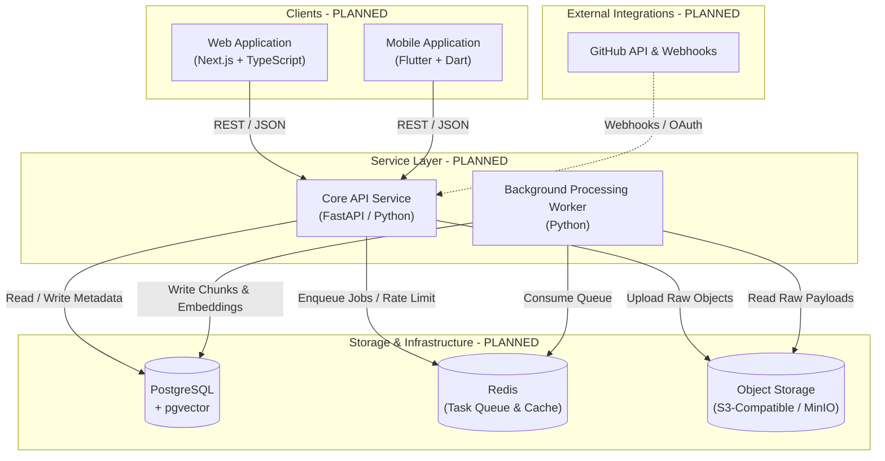

# LENS — Architecture Specification

> **Document Status**: Initial Architectural Direction (Stage 1 / Foundation)  
> **Implementation State**: All architectural components and subsystems described below are currently **PLANNED** and will be implemented incrementally across upcoming stages.

---

## 1. Product Goal

The objective of **LENS** is to provide an effortless, personal information capture and retrieval system. Modern digital work leaves an overwhelming trail of research, documentation, code repositories, discussions, and quick ideas scattered across disjointed platforms. 

LENS solves this fragmentation through a four-phase lifecycle:
1. **Capture**: Instant ingestion from any device with minimal cognitive load.
2. **Understand**: Deep extraction, automated chunking, and contextual enrichment.
3. **Connect**: Semantic indexing, tagging, and cross-reference association.
4. **Retrieve**: High-precision hybrid search that accurately resurfaces relevant information even when exact keywords are forgotten.

---

## 2. System Overview



---

## 3. Component Responsibilities

### 3.1 Web Application (`apps/web/`) — *PLANNED*
* **Technology**: Next.js (App Router), TypeScript, modern CSS.
* **Responsibilities**:
  * Desktop and browser capture interface.
  * Interactive knowledge dashboard with filtering, tagging, and preview cards.
  * Search exploration UI with hybrid search result highlighting and faceted filters.
  * User settings, OAuth connection management, and audit logs.

### 3.2 Mobile Application (`apps/mobile/`) — *PLANNED*
* **Technology**: Flutter, Dart.
* **Responsibilities**:
  * Native OS Share Sheet integration for one-tap captures of URLs, text, and media.
  * Offline-capable capture queue with automatic background synchronization.
  * Fast mobile retrieval and reading mode.

### 3.3 Backend API Service (`services/api/`) — *PLANNED*
* **Technology**: FastAPI, Python 3.11+, Pydantic, SQLAlchemy / SQLModel.
* **Responsibilities**:
  * Ingestion endpoints: Fast validation, immediate persistence of raw capture records, and job dispatching.
  * Search endpoints: Hybrid search coordination (lexical + semantic vector queries).
  * Authentication and authorization enforcement.
  * External webhook receipt and validation (e.g., GitHub webhooks).

### 3.4 Background Worker (`services/worker/`) — *PLANNED*
* **Technology**: Python 3.11+, task queue consumer (e.g., Celery, ARQ, or Redis Streams).
* **Responsibilities**:
  * HTML scraping, metadata extraction (OpenGraph, author, readability text).
  * Text normalization, chunking, and token counting.
  * Vector embedding calculation via embedding models.
  * Periodic synchronization of external data sources (e.g., GitHub starred repositories).

---

## 4. End-to-End Data Flow

```
[Client]                [API]               [Storage / Queue]           [Worker]
   │                      │                         │                      │
   │── 1. Ingest item ───>│                         │                      │
   │                      │── 2. Save raw record ──>│ [PostgreSQL / S3]    │
   │                      │── 3. Enqueue job ──────>│ [Redis Queue]        │
   │<── 4. 202 Accepted ──│                         │                      │
   │                      │                         │                      │
   │                      │                         │<── 5. Pull job ──────│
   │                      │                         │── 6. Fetch raw ─────>│
   │                      │                         │                      │── 7. Chunk & Embed
   │                      │                         │<── 8. Store vectors ─│
```

1. **Ingestion**: Client sends a capture payload (URL, text, or file) to the API.
2. **Persistence**: API saves the base capture record in PostgreSQL and offloads any large binary payload directly to S3-compatible storage.
3. **Queueing**: A processing event is dispatched to Redis.
4. **Immediate Response**: API returns `202 Accepted` (or `201 Created` with a pending status) to ensure the client is never blocked.
5. **Worker Execution**: Worker pulls the job from Redis, extracts meaningful textual content, splits it into semantic chunks, and generates embeddings.
6. **Indexing**: Processed chunks and their vector representations are committed back to PostgreSQL (`pgvector`), updating the capture item status to `READY`.

---

## 5. Storage Subsystems

### 5.1 Primary Database: PostgreSQL + `pgvector` — *PLANNED*
* **Structured Data**: Relational schemas for users, captures, collections, tags, and sync jobs.
* **Vector Indexing**: High-dimensional vector columns storing embedding vectors for text chunks.
* **Indexes**: HNSW (Hierarchical Navigable Small World) or IVFFlat indexes on vector columns for low-latency cosine / Euclidean distance similarity queries.
* **ACID Guarantees**: Keeps metadata, textual content, and vectors unified in a single transactional system, eliminating dual-write consistency problems.

### 5.2 Cache & Task Queue: Redis — *PLANNED*
* **Task Queue**: Asynchronous message passing between API and worker processes.
* **Transient Cache**: Caching search results, user sessions, and external rate limit counters.
* **Pub/Sub**: Real-time event notifications for completed ingestion tasks.

### 5.3 Object Storage: S3-Compatible Storage — *PLANNED*
* **Payload Isolation**: Keeps heavy or binary assets out of PostgreSQL.
* **Supported Media**: Raw HTML dumps, full page snapshots, uploaded PDFs, images, and audio notes.
* **Addressing**: Database records reference assets strictly via deterministic S3 object keys.

---

## 6. GitHub Integration Direction — *PLANNED*

* **OAuth Ingestion**: Secure authorization granting read access to public/private repositories, starred items, and gists.
* **Webhook Receiver**: Webhook listeners to capture new stars, issue updates, and pull requests in near real-time.
* **Sync Engine**: Periodic background reconciliation ensuring external updates are continuously indexed.

---

## 7. Search Architecture Direction — *PLANNED*

LENS employs a **Hybrid Retrieval** strategy:

1. **Lexical (Keyword) Search**:
   * Uses PostgreSQL native full-text search (`tsvector` / `tsquery`).
   * Captures exact tokens, programming identifiers, unique URLs, and acronyms.
2. **Semantic (Vector) Search**:
   * Uses `pgvector` cosine similarity (`<=>`) over embedded content chunks.
   * Captures intent, conceptual similarity, and natural language queries without requiring exact keyword overlaps.
3. **Score Combination (Fusion)**:
   * Merges results using Reciprocal Rank Fusion (RRF) or weighted linear scoring:
     $$\text{Score} = \alpha \cdot \text{LexicalRank} + (1 - \alpha) \cdot \text{VectorRank}$$
   * Produces a single, re-ranked list of top hits with contextual snippet extraction.

---

## 8. Authentication & Authorization Direction — *PLANNED*

* **Phase 1 (Initial)**: Stateless JSON Web Tokens (JWT) signed with HMAC-SHA256 / RS256.
  * Short-lived access tokens accompanied by securely stored refresh tokens.
  * Password hashing utilizing Argon2id or bcrypt.
* **Phase 2 (Extensible)**: Social authentication providers (GitHub OAuth first-class integration, followed by Google).
* **Multi-Tenancy**: Strict tenant isolation across all database queries ensuring private data is never exposed across users.
