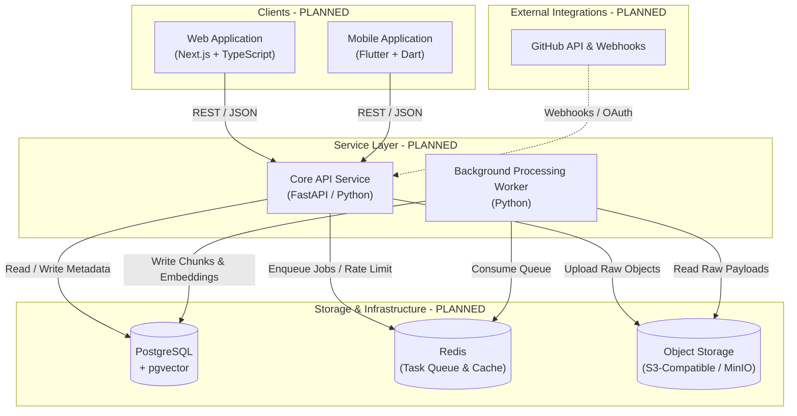
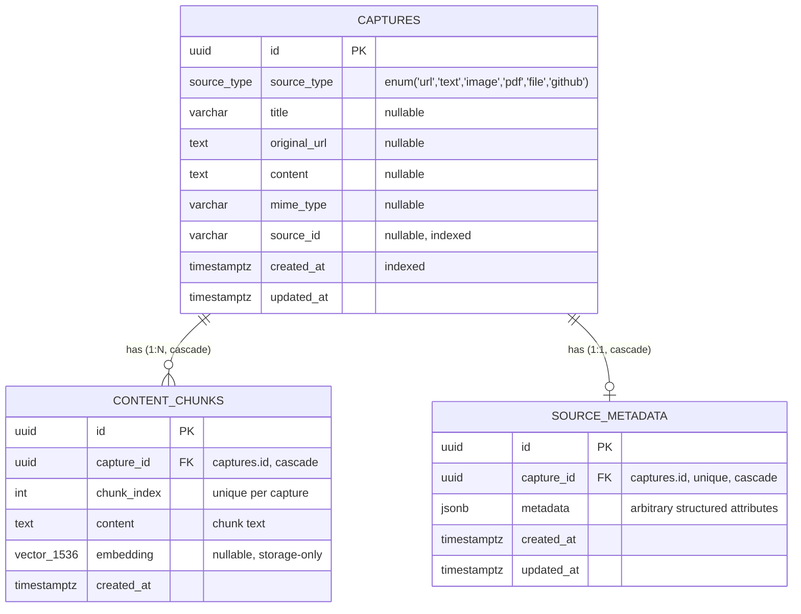

# LENS — Architecture Specification

> **Document Status**: Initial Architectural Direction (Stage 1 / Foundation)  
> **Implementation State**: All architectural components and subsystems described below are currently **PLANNED** and will be implemented incrementally across upcoming stages.

---

## 1. Product Goal

The objective of **LENS** is to provide an effortless, personal information capture and retrieval system. Modern digital work leaves an overwhelming trail of research, documentation, code repositories, discussions, and quick ideas scattered across disjointed platforms. 

LENS solves this fragmentation through a four-phase lifecycle:
1. **Capture**: Instant ingestion from any device with minimal cognitive load.
2. **Understand**: Deep extraction, automated chunking, and contextual enrichment.
3. **Connect**: Semantic indexing, tagging, and cross-reference association.
4. **Retrieve**: High-precision hybrid search that accurately resurfaces relevant information even when exact keywords are forgotten.

---

## 2. System Overview



---

## 3. Component Responsibilities

### 3.1 Web Application (`apps/web/`) — *PLANNED*
* **Technology**: Next.js (App Router), TypeScript, modern CSS.
* **Responsibilities**:
  * Desktop and browser capture interface.
  * Interactive knowledge dashboard with filtering, tagging, and preview cards.
  * Search exploration UI with hybrid search result highlighting and faceted filters.
  * User settings, OAuth connection management, and audit logs.

### 3.2 Mobile Application (`apps/mobile/`) — *PLANNED*
* **Technology**: Flutter, Dart.
* **Responsibilities**:
  * Native OS Share Sheet integration for one-tap captures of URLs, text, and media.
  * Offline-capable capture queue with automatic background synchronization.
  * Fast mobile retrieval and reading mode.

### 3.3 Backend API Service (`services/api/`) — *ACTIVE FOUNDATION (STAGE 3)*
* **Technology**: FastAPI, Python 3.11+, Pydantic, Pydantic-Settings, SQLAlchemy (asyncio), AsyncPG, Redis (asyncio).
* **Current Architectural Implementation (Stage 3 Foundation)**:
  * **Core Application**: Minimal ASGI entrypoint (`app/main.py`) with lifespan management for graceful resource shutdown.
  * **Configuration Layer (`app/core/config.py`)**: Centralized settings backed by `pydantic-settings`. Loads from root `.env` when present, normalizes PostgreSQL DSNs for `asyncpg`, and avoids hardcoded secrets. Does not require unimplemented credentials (JWT, GitHub, AI) to start.
  * **Async PostgreSQL Layer (`app/db/session.py`)**: `AsyncEngine` with connection pooling (`pool_size=10`, `max_overflow=20`, `pool_pre_ping=True`) and active ping validation (`SELECT 1`).
  * **Redis Connectivity (`app/db/session.py`)**: Dedicated asynchronous Redis client providing connection reuse and active `PING` validation.
  * **Health Check Subsystem (`app/health/router.py`)**: Live `GET /health` endpoint verifying end-to-end connectivity to PostgreSQL and Redis. Emits `200 OK` when healthy and `503 Service Unavailable` with degraded status if any dependency fails, without leaking credentials or stack traces.
* **Planned Product Responsibilities (*NOT YET IMPLEMENTED*)**:
  * Ingestion endpoints: Fast validation, immediate persistence of raw capture records, and job dispatching.
  * Search endpoints: Hybrid search coordination (lexical + semantic vector queries).
  * Authentication & user management: JWT generation, verification, and tenant isolation.
  * External webhook receipt and validation (e.g., GitHub webhooks).

### 3.4 Background Worker (`services/worker/`) — *PLANNED*
* **Technology**: Python 3.11+, task queue consumer (e.g., Celery, ARQ, or Redis Streams).
* **Responsibilities**:
  * HTML scraping, metadata extraction (OpenGraph, author, readability text).
  * Text normalization, chunking, and token counting.
  * Vector embedding calculation via embedding models.
  * Periodic synchronization of external data sources (e.g., GitHub starred repositories).

---

## 4. End-to-End Data Flow

```
[Client]                [API]               [Storage / Queue]           [Worker]
   │                      │                         │                      │
   │── 1. Ingest item ───>│                         │                      │
   │                      │── 2. Save raw record ──>│ [PostgreSQL / S3]    │
   │                      │── 3. Enqueue job ──────>│ [Redis Queue]        │
   │<── 4. 202 Accepted ──│                         │                      │
   │                      │                         │                      │
   │                      │                         │<── 5. Pull job ──────│
   │                      │                         │── 6. Fetch raw ─────>│
   │                      │                         │                      │── 7. Chunk & Embed
   │                      │                         │<── 8. Store vectors ─│
```

1. **Ingestion**: Client sends a capture payload (URL, text, or file) to the API.
2. **Persistence**: API saves the base capture record in PostgreSQL and offloads any large binary payload directly to S3-compatible storage.
3. **Queueing**: A processing event is dispatched to Redis.
4. **Immediate Response**: API returns `202 Accepted` (or `201 Created` with a pending status) to ensure the client is never blocked.
5. **Worker Execution**: Worker pulls the job from Redis, extracts meaningful textual content, splits it into semantic chunks, and generates embeddings.
6. **Indexing**: Processed chunks and their vector representations are committed back to PostgreSQL (`pgvector`), updating the capture item status to `READY`.

---

## 5. Local Infrastructure & Storage Subsystems (Stage 2 Foundation)

> [!NOTE]
> The backing storage and caching services defined below are established as **local infrastructure foundations** via `infra/docker-compose.yml`. They represent running containerized infrastructure; application-level database schemas, ORM models, migrations, queue consumers, and bucket management remain **PLANNED** for upcoming stages.

### 5.1 PostgreSQL + `pgvector` (Active Domain Schema — Stage 4)
* **Infrastructure Implementation**: Container `lens-postgres` running `pgvector/pgvector:pg16` on host port `5432` with persisted named volume `lens_postgres_data`.
* **Core Domain Entities (`services/api/app/db/models.py`)**:
  * **`Capture`**: The central entity representing a captured artifact.
    * `id`: UUID (Primary Key)
    * `source_type`: `source_type` Enum (`url`, `text`, `image`, `pdf`, `file`, `github`)
    * `title`: String(512), nullable
    * `original_url`: Text, nullable
    * `content`: Text, nullable
    * `mime_type`: String(128), nullable
    * `source_id`: String(256), nullable (indexed for fast external lookups)
    * `created_at` / `updated_at`: Timezone-aware timestamps with automatic triggers
  * **`ContentChunk`**: Searchable partitioned content units derived from a parent capture.
    * `id`: UUID (Primary Key)
    * `capture_id`: UUID, Foreign Key to `captures.id` (`ON DELETE CASCADE`)
    * `chunk_index`: Integer, required (composite unique constraint `uq_content_chunks_capture_chunk`)
    * `content`: Text, required
    * `embedding`: `Vector(1536)`, nullable (pgvector storage reservation)
    * `created_at`: Timezone-aware timestamp
  * **`SourceMetadata`**: 1-to-1 extension table holding arbitrary source-specific attributes without schema bloating.
    * `id`: UUID (Primary Key)
    * `capture_id`: UUID, Unique Foreign Key to `captures.id` (`ON DELETE CASCADE`)
    * `metadata`: PostgreSQL `JSONB`, required (default `{}`)
    * `created_at` / `updated_at`: Timezone-aware timestamps

#### Entity Relationship Diagram



* **Future Vector Embeddings Role (*STORAGE-ONLY PLACEHOLDER*)**:
  > [!IMPORTANT]
  > At Stage 4, the `embedding` column exists **strictly as a storage capability reservation** using `pgvector`. Vector dimension 1536 is a standard placeholder dimension (compatible with popular dense embedding models such as `text-embedding-3-small`). **No AI generation, external API calls, or automated embedding calculations are implemented at this stage.** Actual embedding generation pipelines will be introduced in subsequent worker/AI stages.

### 5.2 Redis
* **Infrastructure Implementation**: Container `lens-redis` running `redis:7.4.7-alpine` on host port `6379` with persisted named volume `lens_redis_data` and append-only persistence enabled.
* **Future Background Job Queue (*PLANNED*)**:
  * High-throughput asynchronous broker coordinating work between `services/api` and `services/worker`.
  * Reliable task distribution for link scraping, text extraction, chunking, and vector calculation.
* **Caching (*PLANNED*)**:
  * Low-latency caching for frequent search queries, resolved metadata, and user session state.
* **Rate Limiting (*PLANNED*)**:
  * Token bucket / sliding window rate limiting on public and ingestion API endpoints.

### 5.3 MinIO (S3-Compatible Object Storage)
* **Infrastructure Implementation**: Container `lens-minio` running `minio/minio:RELEASE.2025-09-07T16-13-09Z` on host port `9000` (S3 API) and `9001` (Web Console) with persisted named volume `lens_minio_data`.
* **Local S3-Compatible Storage**:
  * Drop-in replacement for AWS S3 / Cloudflare R2 in local development.
  * Standard AWS S3 SDK compatibility across API and worker services.
* **Future Raw Files, Images & Documents (*PLANNED*)**:
  * Storing immutable raw payloads, HTML DOM dumps, uploaded PDFs, screenshots, and audio recordings.
  * Keeps database records lightweight by storing deterministic S3 URI references rather than large BLOBs.

---

## 6. GitHub Integration Direction — *PLANNED*

* **OAuth Ingestion**: Secure authorization granting read access to public/private repositories, starred items, and gists.
* **Webhook Receiver**: Webhook listeners to capture new stars, issue updates, and pull requests in near real-time.
* **Sync Engine**: Periodic background reconciliation ensuring external updates are continuously indexed.

---

## 7. Search Architecture Direction — *PLANNED*

LENS employs a **Hybrid Retrieval** strategy:

1. **Lexical (Keyword) Search**:
   * Uses PostgreSQL native full-text search (`tsvector` / `tsquery`).
   * Captures exact tokens, programming identifiers, unique URLs, and acronyms.
2. **Semantic (Vector) Search**:
   * Uses `pgvector` cosine similarity (`<=>`) over embedded content chunks.
   * Captures intent, conceptual similarity, and natural language queries without requiring exact keyword overlaps.
3. **Score Combination (Fusion)**:
   * Merges results using Reciprocal Rank Fusion (RRF) or weighted linear scoring:
     $$\text{Score} = \alpha \cdot \text{LexicalRank} + (1 - \alpha) \cdot \text{VectorRank}$$
   * Produces a single, re-ranked list of top hits with contextual snippet extraction.

---

## 8. Authentication & Authorization Direction — *PLANNED*

* **Phase 1 (Initial)**: Stateless JSON Web Tokens (JWT) signed with HMAC-SHA256 / RS256.
  * Short-lived access tokens accompanied by securely stored refresh tokens.
  * Password hashing utilizing Argon2id or bcrypt.
* **Phase 2 (Extensible)**: Social authentication providers (GitHub OAuth first-class integration, followed by Google).
* **Multi-Tenancy**: Strict tenant isolation across all database queries ensuring private data is never exposed across users.
